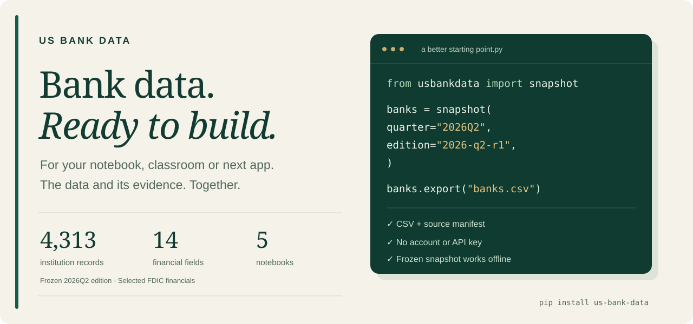

# US Bank Data for Python



[](https://github.com/anshuman-pandey/us-bank-data/actions/workflows/checks.yml)
[](https://pypi.org/project/us-bank-data/)
[](https://pypi.org/project/us-bank-data/)
[](LICENSE)

**A reproducible U.S. bank dataset for your notebook, classroom or next app.**

Load a frozen quarter of FDIC institution financials, select a cohort, or fetch
several banks across the same reporting window. Exports carry units, population,
missing-data coverage and original source evidence.

[Documentation](https://www.banksonsale.com/developers) · [Cohort guide](docs/COHORTS.md) · [14-field dictionary](docs/METRICS.md) · [Releases](https://github.com/anshuman-pandey/us-bank-data/releases)

| Your starting point | Open this |
|---|---|
| **A class, MBA case or hackathon** | [Run the snapshot screener in Colab ↗](https://colab.research.google.com/github/anshuman-pandey/us-bank-data/blob/v0.2.0/notebooks/03_snapshot_screener.ipynb) |
| **A Python application** | [Install and load a quarter ↓](#install) |
| **Polars, DuckDB or SQL** | [Follow the Parquet lesson ↗](https://colab.research.google.com/github/anshuman-pandey/us-bank-data/blob/v0.2.0/notebooks/05_polars_duckdb_bank_data.ipynb) |
| **A spreadsheet, without Python** | [Download CSV + source manifest ↓](#download-without-python) |

<br />

## Install

Python 3.10 or newer:

```bash
python -m pip install us-bank-data==0.2.0
```

No account, API key, paid service or background telemetry. The base package
reuses the public `banksonsale-data` standard-library engine. pandas, Polars,
PyArrow and DuckDB are optional; `us-bank-data[teaching]==0.2.0` installs the
libraries used in all classroom lessons.

## Start offline with a complete quarter

```python
from usbankdata import snapshot

data = snapshot(quarter="2026Q2", edition="2026-q2-r1")
print(len(data.rows))  # 4313
data.export("banks.csv")  # also writes banks.manifest.json
```

The bundle contains **4,313 institution financial records for June 30, 2026**,
including noninsured institutions and insured U.S. branches of foreign
institutions. It is not an insured-only or active-only population, or a list of
banks for sale. It is a frozen edition, not a latest-data claim. Original source
responses and retrieval dates are included; this call works offline.

## Download without Python

Use the same **normalized U.S.-dollar** data from the v0.2.0 release:

| File | What to keep |
|---|---|
| [CSV ↗](https://github.com/anshuman-pandey/us-bank-data/releases/download/v0.2.0/us-bank-financials-2026-q2.csv) | Pair it with the [source manifest ↗](https://github.com/anshuman-pandey/us-bank-data/releases/download/v0.2.0/us-bank-financials-2026-q2.manifest.json). |
| [Parquet ↗](https://github.com/anshuman-pandey/us-bank-data/releases/download/v0.2.0/us-bank-financials-2026-q2.parquet) | Includes the manifest in its `usbankdata` metadata. |
| [SHA-256 checksums ↗](https://github.com/anshuman-pandey/us-bank-data/releases/download/v0.2.0/SHA256SUMS) | Verify the files before reusing the edition. |

These files have the same 4,313-record population and frozen reporting date
described above. The separate [website source edition](https://www.banksonsale.com/data/releases/2026-q2-r1)
retains FDIC USD-thousands; its format and units differ from these package exports.

## Select banks at an explicit quarter

```python
cohort = data.select(
    states=["NC"], bank_classes=["N", "SM", "NM", "SB", "SI", "SL"],
    min_assets_usd=100_000_000, max_assets_usd=3_000_000_000,
)
print(cohort.certs)
print(cohort.document["coverage"])
cohort.export("nc-bank-cohort.json")
```

The asset minimum is inclusive and maximum exclusive. The manifest records
the selection anchor and filters. Missing values stay missing; zero stays zero.
These research filters are examples, not an official peer group. `select()`
requires a single-quarter input and supports legitimate empty results.

## Align several banks across the same quarters

```python
from usbankdata import panel

history = panel(certs=[628, 3510, 58665], through="2026Q2", quarters=8)
history.export("bank-history.json")
```

This makes live FDIC requests for up to **100 explicit banks and 40 quarters**.
The end quarter is required. Pagination, retries and timeouts are bounded.
Every selected bank has one row per requested quarter; absent filings are
explicit and never filled with older reports. There is no current-active
selection filter. `load_sample_cohort()` provides three offline eight-quarter
interface samples; those banks are not a matched or representative peer group.

## Use your existing tools

```python
frame = cohort.to_pandas()        # optional us-bank-data[pandas]
polars_frame = cohort.to_polars() # optional us-bank-data[polars]
cohort.export("banks.parquet")    # optional us-bank-data[parquet]
```

CSV includes an evidence sidecar. JSON is self-contained and reloads with
`BankCohort.load()`. Parquet embeds the manifest under `usbankdata`; pandas
uses `frame.attrs["usbankdata"]`. Generic rewrites can discard that evidence.
The SQL lesson queries the same Parquet with Polars and DuckDB and checks
that counts, total assets and missingness agree.

## Run a lesson

| Notebook | Task | Open |
|---|---|---|
| [Snapshot screener](notebooks/03_snapshot_screener.ipynb) | Select a quarter-wide population and derive a funding measure. | [Colab](https://colab.research.google.com/github/anshuman-pandey/us-bank-data/blob/v0.2.0/notebooks/03_snapshot_screener.ipynb) |
| [Cohort history](notebooks/04_cohort_history.ipynb) | Compare three offline samples across eight aligned quarters. | [Colab](https://colab.research.google.com/github/anshuman-pandey/us-bank-data/blob/v0.2.0/notebooks/04_cohort_history.ipynb) |
| [Polars and DuckDB](notebooks/05_polars_duckdb_bank_data.ipynb) | Use lazy dataframe queries and SQL on the same Parquet. | [Colab](https://colab.research.google.com/github/anshuman-pandey/us-bank-data/blob/v0.2.0/notebooks/05_polars_duckdb_bank_data.ipynb) |
| [One-bank financials](notebooks/01_bank_financials.ipynb) | Inspect units and export a legacy single-bank sample. | [Colab](https://colab.research.google.com/github/anshuman-pandey/us-bank-data/blob/v0.2.0/notebooks/01_bank_financials.ipynb) |
| [Same-quarter comparison](notebooks/02_compare_banks.ipynb) | Compare samples using standard-library SQL. | [Colab](https://colab.research.google.com/github/anshuman-pandey/us-bank-data/blob/v0.2.0/notebooks/02_compare_banks.ipynb) |

Notebooks include population notes and attribution; new cohort lessons include
exercises. CI executes the notebooks against the release. Colab has its own
account requirements; local lessons work offline after installation.

## Understand the observations

Fourteen selected fields cover assets, total/domestic deposits, equity,
intangibles, net loans, estimated uninsured deposits, core deposits, CET1,
leverage, ROA/ROE, offices and employees.

- `_usd` is **U.S. dollars**, converted once from source USD-thousands.
- `_pct` is **percent**: 12.5 means 12.5%. ROA/ROE are already annualized.
- CET1 is **RBCT1CER**; leverage is **RBC1AAJ**. They are distinct.
- Null, reported zero, negative values and absent filings remain distinct.
- CERT identifies an institution, not its listed parent, ticker or branch.

Live data may revise past reports. Identity labels reflect retrieval time,
not a historical identity graph. Reporting quarters and archived retrievals
do not establish original-filing availability for backtests. Coverage is
selected FDIC financials, not all Call Reports, NCUA or every type of bank data.

## Existing single-bank code continues to work

```python
from usbankdata import bank, load_sample, search

sample = load_sample(58665)
matches = search("Live Oak", state="NC")  # inspect candidates and choose a CERT
live = bank(58665).financials(quarters=8, through="2026Q2")
```

Legacy `banksonsale_data` imports and single-bank evidence remain unchanged.
The independent [OpenBB extension](integrations/openbb) is available from
source; it is not bundled into or endorsed by OpenBB.

## Source and reuse

Original source: [FDIC BankFind Suite](https://api.fdic.gov/banks/docs/).
Code: MIT. Original compilation and metadata: CC BY 4.0. Credit **US Bank Data;
BanksOnSale compilation and metadata, sourced from FDIC BankFind Suite**, with
edition, report date and dataset ID. No FDIC endorsement is implied.

See [data licensing](packages/us-bank-data/DATA_LICENSE.md),
[cohort contract](docs/COHORTS.md), [legacy contract](docs/DATA_CONTRACT.md),
[CITATION.cff](CITATION.cff) and [CONTRIBUTING.md](CONTRIBUTING.md).

---

**Build something useful. Keep it reproducible.**

[Report a data issue](https://github.com/anshuman-pandey/us-bank-data/issues) ·
[Contribute a lesson](CONTRIBUTING.md) ·
[Explore the hosted bank research workspace](docs/CONTINUE_IN_BANKSONSALE.md)
